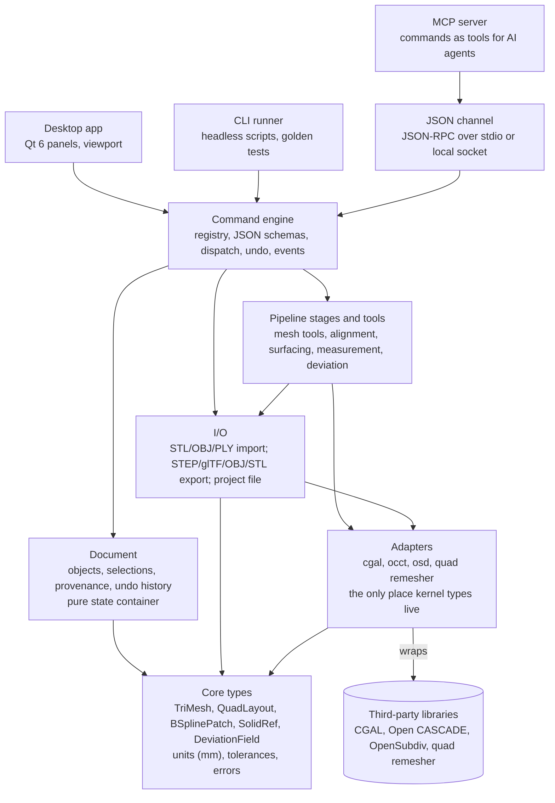
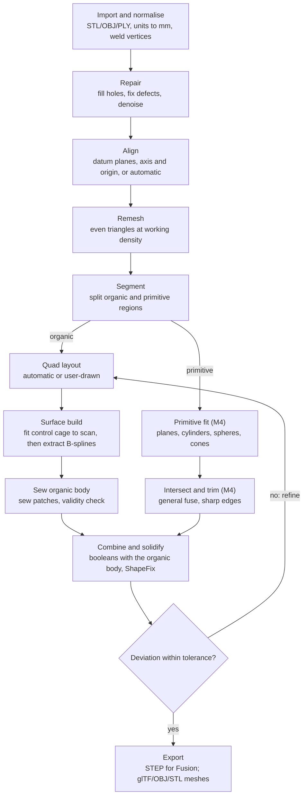

# Scan-to-CAD Reverse Engineering App — Architecture & Roadmap

Last updated: 17 October 2026 (revision 4: brought in line with what M2 built; see "Status after M2" in section 12. Revision 3 did the same for M0 and M1; revision 2 applied a technical review, see section 15)

## 1. Purpose and scope

The app turns 3D scans of any shape, from a plain cube or machined bracket to organic, mostly non-flat objects such as a console game controller, into watertight solids that Fusion 360 opens as editable bodies, plus clean meshes for Blender. It is open source (GPL v3) or internal-use software, not a commercial product.

**In scope for v1.0**

- Import STL, OBJ and PLY meshes of any practical size (target: 10M+ triangles).
- Mesh tidy-up: clean-up, hole filling, smoothing, simplification of large meshes to a target point or triangle count, and a shrink-wrap fallback for scans too damaged for surface repair.
- Alignment: move the scan into a sensible coordinate system before surfacing, either 3-2-1 datum alignment (primary plane, secondary plane or axis, origin point) or automatic alignment by principal axes or symmetry plane, so the part lands square to Fusion 360's origin planes.
- Shell detection: find separate, unconnected meshes (stray scan fragments, loose parts), then highlight, split, keep or delete them.
- Organic auto-surfacing: scan to a network of smooth NURBS patches, sewn into a valid solid.
- Prismatic reconstruction: exact planes, cylinders, cones, spheres and tori, plus sketched lines, arcs and curves, for whole prismatic parts (a cube, a bracket) and for the flat and round features of organic parts.
- Measurement: point-to-point distance on meshes and CAD surfaces.
- Deviation analysis from the scan mesh to the generated surfaces, shown as a colour map that highlights where and by how much they differ.
- Export: STEP AP242 for Fusion 360; glTF/GLB, OBJ and STL for Blender and 3D printing.
- One command engine: every action is a command, so the UI, the CLI, a JSON control channel and an MCP server all drive the same engine.

**Explicit non-goals.** Anything here needs a new decision record (section 14) before any work starts.

- Parasolid (.x\_t) export. It requires a proprietary kernel that cannot ship in a GPL app.
- IGES export. Deferred; STEP covers both target applications.
- A general parametric CAD modeller: fillets, assemblies, drawings, full constraint sketching. Fusion does this after import.
- Raw point-cloud processing, scan registration and scanner drivers. v1 assumes the input is already a mesh.
- Plugin systems, an embedded scripting language, cloud features and collaboration. The command API (section 8) is the automation surface.

**Definition of success for v1.0:** a controller scan of 1–5M triangles converts to a STEP file that Fusion 360 imports as a single solid body, within 0.1 mm of the scan on 95% of sampled points, in under 5 minutes on a current desktop. A prismatic scan such as a cube or bracket converts to exact planes and cylinders with sharp edges, not rounded freeform patches. These targets are accepted for now and can be tightened at the M3 gate.

## 2. Guiding principles

Nine rules keep the codebase small, testable and changeable. When a design choice is unclear, these decide it.

1. **Stages are functions on explicit data.** Each pipeline stage takes input data plus parameters and returns output data plus a report. No hidden global state, no singletons. This makes stages testable, re-runnable and easy to undo.
2. **Kernel types never leak.** OCCT, CGAL and OpenSubdiv types stay inside their adapter modules. Everything above the adapters uses app-owned types. A library can then be replaced or upgraded without touching the UI or pipeline.
3. **Dependencies point one way.** Front ends → commands → document, pipeline and I/O → adapters → core. The document is a pure state container that depends only on core. CMake targets enforce this; a lower layer never includes a higher one.
4. **The document is the single source of truth.** Every action is a registered command, and commands are the only way to change it. The UI, CLI, JSON channel and MCP server are thin front ends over the same command engine; none of them owns geometry or contains logic the others lack. The purpose is that an AI agent can work on the same meshes as a person in the UI, with the same tools and the same results.
5. **Units and tolerances are explicit.** Millimetres and double precision everywhere internally. Every geometric operation takes a named tolerance rather than a hard-coded epsilon.
6. **Deterministic output.** On a given platform and build, the same input and parameters produce bit-identical results: seeded randomness, stable sort orders, no dependence on thread timing, and deterministic parallel reductions. Floating-point results are not bit-identical across compilers or platforms, so cross-platform comparisons always use metric tolerances, never exact coordinates. Section 9 sets the compiler flags this needs.
7. **Use libraries before writing algorithms.** Check CGAL, OCCT and OpenSubdiv first. Writing our own geometry code needs a stated reason.
8. **Build only what the current milestone needs.** No speculative abstractions, plugin points or configuration layers. An interface exists only when two implementations exist or are scheduled.
9. **Correctness first, then measured speed.** Optimise only against a profiled benchmark from the golden test set.

## 3. Technology stack and licensing

The core is C++23, licensed GPL-3.0-or-later, and every dependency must be GPL v3 compatible. Rust is allowed only for isolated modules behind a C interface, and only after a decision record shows a concrete benefit.

| Area | Choice | Licence | Role |
| --- | --- | --- | --- |
| Language | C++23 (MSVC 17.10+, GCC 13+; Clang only with libc++, see ADR-019) | n/a | All core code, including the JSON channel and MCP server; C++23 is needed for `std::expected` |
| Build | CMake presets + vcpkg (manifest mode, pinned baseline) | MIT | Reproducible builds on Windows and Linux |
| UI | Qt 6 Widgets | LGPL v3 | Windows, docks, panels, dialogs |
| Viewport | Custom OpenGL renderer in a Qt widget | n/a | Large-mesh rendering with level of detail |
| Mesh processing | CGAL | GPL v3 / LGPL v3 | Repair, hole filling, smoothing, simplification, shells, alpha wrapping, shape detection, AABB trees |
| Quad remeshing | Instant Meshes core, single-threaded (ADR-009); QuadWild (bi-MDF) to revisit at M3 | BSD-3-Clause | Automatic quad patch layout |
| Subdivision | OpenSubdiv | Apache 2.0 | Quad mesh to B-spline patches |
| Linear algebra | Eigen | MPL 2.0 | Least-squares surface fitting |
| CAD kernel | Open CASCADE (OCCT) | LGPL 2.1 + exception | B-rep, sewing, booleans, STEP, tessellation, point projection |
| Parallelism | oneTBB | Apache 2.0 | Shared by CGAL, OCCT and our stages |
| JSON and schemas | nlohmann/json + json-schema-validator | MIT | Command parameters, results, JSON-RPC and MCP messages |
| Mesh file parsing | tinyobjloader, happly, own STL reader | MIT | Import |
| Project archive | miniz | MIT | Read and write the zipped project file |
| Logging | spdlog | MIT | Structured logs, stage reports, session command log |
| Testing | Catch2 + libFuzzer | BSL 1.0 / Apache 2.0 | Unit, stage, golden, command and fuzz tests |

**In use after M1.** C++23, CMake presets with vcpkg or pinned downloads (ADR-020, ADR-022), Qt 6 Widgets with the custom OpenGL viewport, CGAL, Eigen (plane fits, principal axes, symmetry, CGAL fairing), nlohmann/json, miniz and Catch2. Not used yet: oneTBB (everything is single-threaded apart from background index builds), json-schema-validator (schemas are published but each handler checks its own parameters), spdlog (the session log is plain JSON lines), OCCT, OpenSubdiv and a quad remesher. Own OBJ and PLY parsers replaced tinyobjloader and happly (ADR-021), and fuzzing uses a fixed-seed driver as well as a libFuzzer entry point, because MSVC and GCC have no libFuzzer. `THIRD_PARTY.md` lists what is actually linked.

**Licence rules**

- Every dependency is listed in `THIRD_PARTY.md` with its licence and why it is needed.
- Adding a dependency requires a decision record. AI tools add libraries freely, so this rule matters.
- Qt and OCCT are linked dynamically to keep their LGPL terms simple.
- Library versions are pinned by the vcpkg baseline and upgraded deliberately, one library per change.

## 4. System architecture

The app is a set of strictly layered modules, each a CMake target, with every dependency pointing downward. Two boundaries matter most: the command engine, which every front end goes through, and the adapters layer, the only code that sees CGAL, OCCT or OpenSubdiv types.



The command engine is the orchestrator: it calls pipeline and I/O functions, then commits their results to the document as one undo step. The document never calls processing code, which keeps it small, fast to compile and easy to test. All four front ends call the same command engine, so anything the UI can do can also be scripted, tested headless, or driven by an AI agent through MCP, with identical results.

The rules below are enforced on every build by `scripts/check_layers.py` (a ctest and a CI step), which reads each file's `#include "m2c/<module>/..."` lines and rejects kernel headers outside `src/adapters/`.

| Module | May depend on | Must never depend on |
| --- | --- | --- |
| app | commands, rpc, document (read-only snapshots from the engine thread), core, Qt | pipeline, io, adapters, any kernel header |
| cli | commands, document, core | Qt, pipeline, io, adapters |
| rpc (JSON channel) | commands, document, core | Qt, pipeline, io, adapters |
| mcp | rpc, commands, document, core | Qt, pipeline, io, adapters |
| commands | document, pipeline, io, core | Qt, adapters, any front end |
| document | core | Qt, commands, pipeline, io, adapters |
| pipeline | adapters, core, Eigen | Qt, document, commands, io |
| io | core, adapters (for BREP in the project file and STEP), miniz | Qt, document, pipeline |
| adapters | core, their own third-party library | each other, anything above them |
| core | standard library | everything else |

## 5. Core data model

All pipeline data is app-owned, immutable once created, and shared through `std::shared_ptr<const T>`. Immutability makes undo cheap (keep the old pointer), makes worker threads safe, and stops stages from quietly changing each other's data.

| Type | Contents | Produced by | Notes |
| --- | --- | --- | --- |
| `TriMesh` | Positions (double), triangle indices, optional normals and per-vertex attributes, each held as a separately shared immutable buffer; plus a lazily built, thread-safe spatial index (BVH) | Import, repair, remesh, alignment | Converted to CGAL `Surface_mesh` inside the CGAL adapter and back. A tool that only moves vertices shares the unchanged index buffer |
| `MeshSelection` | Compressed bitset of selected face (or vertex) indices on one mesh | Selection commands: brush, lasso, flood fill by crease, grow, shrink, invert | Commands take a `selection_id`, never inline index lists |
| `Transform3d` | Rigid transform (rotation plus translation) and the datum features it came from | Alignment | Applied to a mesh as a new `TriMesh`; stored so alignment can be inspected and redone |
| `FaceLabels` | One region id per triangle, plus region kind (organic, plane, cylinder, ...) | Segmentation | Drives the organic vs primitive split |
| `CurveOnMesh` | Polyline stored as face id + barycentric coordinates | Feature detection, user drawing | Sharp edges and manual patch boundaries |
| `QuadLayout` | Quad mesh, extraordinary vertex list, link from each quad to scan region | Quad layout stage | The patch structure of the final surface |
| `BSplinePatch` / `SurfaceModel` | Degree, knots, control points per patch; patch adjacency and shared edges | Surface construction | Plain data, converted to OCCT only at sewing |
| `SolidRef` | Opaque handle to a B-rep held inside the OCCT adapter | Sew and solidify, feature ops | The only opaque type; queried through adapter functions |
| `DeviationField` | Signed distance per scan vertex, plus statistics (max, mean, 95th percentile) | Deviation analysis | Drives the colour map and the accept/refine decision |
| `StageReport` | Timings, warnings, metrics, parameters used | Every stage | Shown in the UI log and checked by golden tests |

Two further types support the tools in section 7. `ShellList` holds each connected component of a mesh with its triangle count, surface area, bounding box and a flag for the main part. `Measurement` holds two picked points (each with the object and element it snapped to), the distance and the X, Y and Z deltas. Both are document objects, so they are saved, undoable and readable through commands.

**Spatial index.** Brush selection, ray picking, measurement snapping, curves drawn on the mesh, fitting and deviation all need fast nearest-point and ray queries. Each `TriMesh` builds its bounding-volume hierarchy once, on first use, and every later query reuses it. Because meshes are immutable, the index never goes stale. Its memory counts towards the golden-set memory budget.

**Buffer sharing.** Whole-object immutability is kept, but the large arrays inside a `TriMesh` are shared individually. Smoothing a brushed region creates a new positions buffer and reuses the indices; deleting fragments creates new indices and reuses nothing it does not have to. This keeps undo history affordable on 10–20M-triangle scans.

**Document and provenance.** The document holds objects by id. Each object records the stage and parameters that produced it and the ids of its inputs. This gives a lightweight history: a stage can be re-run with new parameters without a full parametric feature tree.

**Project file.** A zip (written with miniz) holding a versioned JSON manifest, meshes as binary PLY, selections as compressed bitsets and solids as OCCT BREP. Reading and writing it lives in the I/O module, because BREP serialisation needs the OCCT adapter; the command engine moves the loaded objects into the document. Each schema version has a migration function and a test.

**As built (M1).** `TriMesh` holds positions and triangle indices only (no normals or attributes yet), each as a shared immutable buffer, plus two lazily built caches that copies share: the BVH (`spatialIndex()`) and the face adjacency (`faceAdjacency()`) that selection and smoothing use. `MeshSelection`, `Transform3d` (stored on each mesh as its accumulated alignment) and `Measurement` exist; shell lists are returned by `shells.detect` rather than stored. There is no `StageReport` type: each command returns a JSON `report`. The project file holds a version-1 manifest, meshes as binary PLY, selections as raw bitsets and measurements in the manifest; no migration exists yet because there is only one version. The other types in the table arrive with their milestones.

**Decision point.** If profiling shows that converting `TriMesh` to CGAL and back dominates run time on large scans, record a decision to adopt `Surface_mesh` as the core mesh type. Do not make that change speculatively.

## 6. The organic scan-to-CAD pipeline

A sequence of gated stages turns a raw scan into a solid. After repair the scan is aligned to a datum coordinate system. Organic regions then go through quad layout and surface building, which ends in sewing a closed organic body. Flat and round features go through primitive fitting from M4, where neighbouring primitives are intersected and trimmed against each other, then combined with the organic body by booleans. A deviation check loops back to the layout until accuracy is met.



If the check fails, the user (or an automatic rule) adds patches where deviation is high and reruns layout and surface building. Earlier stages are not rerun.

**Stage contracts.** Each stage has a fixed input, output and gate. A stage must not start unless the previous gate passed.

| Stage | Input → output | Library | Gate before the next stage |
| --- | --- | --- | --- |
| Import and normalise | file → `TriMesh` | Own parsers | Finite coordinates, units set, duplicate vertices welded |
| Repair | `TriMesh` → `TriMesh` | CGAL hole filling, self-intersection removal, smoothing | Closed, manifold, single component (or user-confirmed parts) |
| Align | `TriMesh` + datum features → `Transform3d`, aligned `TriMesh` | Least-squares plane and axis fits, principal component analysis, symmetry detection | Datum features fitted within residual limit; user has confirmed the result |
| Remesh | `TriMesh` → `TriMesh` | CGAL isotropic remeshing | Target edge length met; deviation from input below limit |
| Segment | `TriMesh` → `FaceLabels`, `CurveOnMesh` | CGAL shape detection, curvature | Every face labelled |
| Quad layout | organic region → `QuadLayout` | Quad remesher, or user curves | All quads valid; patch count within target |
| Surface build | `QuadLayout` + scan → `SurfaceModel` | OpenSubdiv limit stencils, Eigen sparse least squares | Shared edges coincide within tolerance; tangents match within angle limit |
| Primitive fit (M4) | region → exact surface | CGAL shape detection, least squares | Fit residual below limit |
| Sew organic body | `SurfaceModel` → closed organic `SolidRef` | OCCT `BRepBuilderAPI_Sewing`, ShapeFix | One closed shell; no free edges |
| Intersect and trim (M4) | fitted primitives → trimmed faces with shared edges | OCCT General Fuse (`BRepAlgoAPI_BuilderAlgo`, `BRepAlgoAPI_Splitter`) | Every primitive face bounded; sharp edges where neighbours meet |
| Combine and solidify | organic body + trimmed primitives → `SolidRef` | OCCT fuzzy booleans (`BRepAlgoAPI_Fuse`, `BRepAlgoAPI_Cut`), ShapeFix | One closed solid that passes `BRepCheck_Analyzer` |
| Deviation check | `SolidRef` + scan → `DeviationField` | OCCT point projection, parallel with oneTBB | 95th percentile within the user tolerance |

**How surface build works.** Fitting happens on the control cage, before any patches are extracted. The order matters.

1. **Treat the quad layout as a Catmull-Clark control cage.** Its limit surface is curvature-continuous (C2) everywhere except at extraordinary vertices, where fewer or more than four edges meet; there it is still tangent-continuous (G1).
2. **Fit the cage to the scan.** OpenSubdiv's limit stencils express each limit-surface point as a fixed linear combination of cage vertices. Solve the sparse least-squares system S · P = X (stencils S, cage vertices P, scan points X), with a small smoothing term so the cage stays fair. Because only the cage moves, continuity across patches is preserved automatically, with no cross-patch constraints.
3. **Extract B-spline patches.** Around each extraordinary vertex, apply two or three levels of adaptive feature isolation. Each regular region then converts exactly to a bicubic B-spline patch. The small cap left at each extraordinary vertex cannot be represented exactly as a non-rational B-spline: OpenSubdiv's Gregory patches use rational blending that OCCT's `Geom_BSplineSurface` cannot hold. Fill each cap instead with one higher-degree B-spline patch (for example degree 5), fitted under position and tangent constraints to its neighbours with OCCT `GeomPlate` or constrained least squares. Its gap and angle errors must stay well inside the sewing tolerance.

Never adjust control points of extracted patches one patch at a time. Doing so breaks tangent continuity at patch boundaries, which leads to kinked edges, failed sewing or an invalid solid.

**Alignment.** Raw scans arrive at whatever position and angle the scanner used. Exported unaligned, a bracket's flat faces and symmetry planes match none of Fusion 360's origin planes, and section sketches have no sensible reference. The alignment stage offers 3-2-1 datum alignment (fit a primary plane to Z = 0, a secondary plane or axis to the X axis, and an origin point) and automatic alignment by principal axes or a detected symmetry plane. The result is a stored rigid `Transform3d` applied before remeshing, so all later stages, sketches and the exported STEP share the aligned frame.

**Keeping the face count low.** From M3, neighbouring regular patches are merged into larger multi-span B-spline surfaces. Fusion stays responsive with hundreds of faces, not thousands.

## 7. Tools and export

The tools fall into five groups: mesh tidy-up, selection and shell detection (M1), alignment (M1), measurement (M1), deviation analysis (M2, refined in M3) and prismatic and feature tools (M4). Each tool is a registered command, so it works the same from the UI, CLI, JSON channel and MCP server.

**Mesh tools (M1)**

| Tool | What it does | Implementation | Key parameters |
| --- | --- | --- | --- |
| Clean-up | Removes duplicate and degenerate faces, non-manifold edges, self-intersections and spikes | CGAL Polygon Mesh Processing | `remove_self_intersections` (built as `mesh.repair`; spike removal is not implemented) |
| Hole filling | Fills open boundaries with a patch that blends into the surrounding curvature; holes above a size limit are left so real openings survive. Rims CGAL cannot triangulate (every diagonal already an edge, as in folded pockets) get a refined and faired centroid fan | CGAL hole filling with fairing | `max_perimeter_mm`, `max_edges`, `fair` |
| Smoothing | Taubin smoothing (no shrinkage), optionally keeping sharp edges, on the whole mesh or a selection | Own Taubin filter (CGAL shape smoothing not used yet) | `iterations`, `strength`, `preserve_sharp_edges`, `sharp_angle_deg` |
| Simplification | Reduces large meshes to a target triangle count, or to a maximum error, whichever comes first, keeping open boundaries | CGAL Garland-Heckbert edge collapse with bounded-distance placement | `target_faces` or `target_ratio`, `max_error_mm` |
| Remesh | Rebuilds an even triangle mesh at a set edge length | CGAL isotropic remeshing | `target_edge_mm` |
| Shrink-wrap | Rebuilds a guaranteed watertight, manifold, self-intersection-free mesh around a badly damaged scan or polygon soup, as a fallback when surface repair fails | CGAL 3D Alpha Wrapping | `alpha_mm`, `offset_mm` (fine detail smaller than these is lost) |
| Shell detection | Finds unconnected meshes (stray fragments, loose parts), marks the largest as the main part, and lists the rest with size and area | Own face components on the cached adjacency | `min_faces` or `min_area_mm2` (for `shells.clean`) |

**Selection.** Brush, lasso, flood fill by crease angle, grow, shrink and invert are commands that produce a `MeshSelection` document object. Tools such as smoothing, deletion and primitive fitting take its `selection_id`, so the UI and an AI agent select regions the same way, and no command ever carries large index lists in JSON.

Shell detection results appear in a panel where each shell can be highlighted, selected, split into its own object, kept or deleted. One action removes every fragment below a size threshold.

**Measurement (M1)**

- Point-to-point distance: click two points; each snaps to a vertex, an edge or a point on the surface, on meshes and CAD surfaces alike. Picking uses a CPU ray cast against the full-resolution spatial index (or the exact B-rep surface), so it stays accurate while the viewport shows a decimated proxy.
- The result shows the distance and the X, Y and Z deltas, in millimetres.
- Measurements are saved document objects, listed in a panel, and available as the `measure.distance` command, so scripts and AI agents get the same numbers.
- Angle, radius and point-to-plane measurements are backlog items.

**Deviation analysis (M2, refined in M3)**

- Computes the signed distance from every scan point to the nearest point on the generated surfaces. Positive means the scan lies outside the surface.
- A colour map on the scan mesh or on the surfaces: a neutral colour inside the tolerance band, then increasingly strong colours for deviation outward and inward. The range and tolerance are user-set, and a colour-blind-safe palette is available.
- A legend, a histogram and statistics: maximum, mean, RMS, 95th percentile and the share of points within tolerance.
- A probe shows the exact value under the cursor; a worst-regions list moves the camera to each problem area.
- The same tool compares two meshes, for example before and after smoothing, so tidy-up effects can be checked.
- Report export: statistics as CSV plus a screenshot of the colour map.
- Implementation: a bounding-volume hierarchy over the tessellated surfaces finds candidates; OCCT point projection refines them; oneTBB runs it in parallel.

**Prismatic and feature tools (M4)**

Prismatic parts are a first-class case, not an add-on. For a cube or bracket, every segmented region is fitted as an exact surface. Fitted primitives are unbounded (an infinite plane or cylinder), so they are not sewn: neighbouring surfaces are intersected and trimmed against each other with OCCT's General Fuse algorithm to give sharp edges, and the result is closed into a solid. No subdivision surfacing is used. On mixed parts, the organic body is sewn first, then trimmed primitives are fused to it or cut from it by booleans.

- **Primitive fitting.** The user selects a mesh region, or accepts one from segmentation, and fits a plane, cylinder, sphere or cone (CGAL shape detection, then least-squares refinement). The result is an exact OCCT surface. Fitted primitives can then be made exactly parallel, perpendicular or at a set angle to each other, to the mean of several, or to a world axis or plane, and refitted with that direction held, since a scanned face's normal is often a little off.
- **Section sketches.** Cut the mesh with a plane, fit lines, arcs and splines to the section polyline, then extrude or revolve the 2D profile (OCCT prism and revolution).
- **Booleans.** Subtract or unite primitives and extrusions with the organic body, using OCCT fuzzy booleans with the project tolerance.
- **No constraint solver in v1.** Sketches are fitted, not constrained. A solver (for example SolveSpace's, GPL v3) is a backlog item that needs its own decision record.

**Export**

| Format | Target | Implementation | Key settings |
| --- | --- | --- | --- |
| STEP AP242 | Fusion 360 (primary) | OCCT STEP writer | Units mm, one solid per body, validity check before writing |
| glTF / GLB | Blender | OCCT tessellation, then OCCT glTF writer | Chord deviation and angle, in mm and degrees |
| OBJ | Blender, general | OCCT tessellation, then OCCT OBJ writer | Same tessellation settings |
| STL | 3D printing | OCCT tessellation, then STL writer | Binary by default |
| PLY / OBJ (raw mesh) | Exporting the repaired scan itself | Own writer from `TriMesh` | Unchanged mesh data |

**Export acceptance.** Every STEP export is re-imported by OCCT in the test suite and must pass `BRepCheck_Analyzer` as one closed solid. At each milestone gate, the golden-set STEP files are also opened in Fusion 360 by hand, using a written checklist.

IGES is a backlog item. Parasolid is a non-goal.

## 8. UI, viewport and command engine

The UI is a thin shell over the document: Qt 6 Widgets for panels, a custom OpenGL viewport, and a command system that owns every change and every undo.

**Layout.** Viewport in the centre. Object tree on the left. A pipeline panel listing the stages in order, so the user can step through them like a guided workflow. A properties panel for the selected stage's parameters. A log panel showing stage reports. A deviation legend when a colour map is displayed.

**Viewport**

- Meshes are uploaded to the GPU as float32 buffers in chunks, so no single buffer limit is hit on large scans.
- Level of detail: while orbiting, draw a decimated proxy; when the camera stops, draw full resolution. Target: 30 fps or better while orbiting a 10M-triangle scan.
- Point picking (measurement, probing, snapping, curve drawing) uses a CPU ray cast against the mesh's spatial index or the exact B-rep. It takes well under a millisecond and returns true triangle ids even while the viewport is drawing a decimated proxy.
- Area selection (lasso) is a command that takes the screen polygon and camera matrix and selects by projection with BVH visibility tests (ADR-024), so it is reproducible from the session log. An R32UI id buffer may be added later as an accelerator that gives the same result.
- Tools: brush and lasso selection on the mesh, shell highlighting, section plane, curve drawing on the surface, point-to-point measurement with snapping, colour maps for deviation and curvature with a value probe.
- B-rep display uses OCCT tessellation converted to the same render path. OCCT's own viewer is not used.

**Command engine and control channels**

- **Every action is a command.** A command has a dotted name (`mesh.smooth`, `shells.detect`, `measure.distance`, `surface.build`), JSON Schemas for its parameters and result, a handler, and a kind: query (read-only) or mutation (undoable). A command that writes the file named by its `path` parameter (an export, a save, a picture) says so (`writesFiles`), and every `path` parameter names the file types it takes (`x-file-types`), so front ends offer the right files and do not present a file write as read-only (ADR-031).
- **One registry, four front ends.** UI menus and panels, CLI subcommands, JSON-RPC methods and MCP tools all come from the registry. A new command is available everywhere at once; no front end has private commands or extra logic.
- **One dispatch path.** Validate parameters against the schema, run the handler (on a worker thread if long), apply the result to the document as one undo step, then emit an event. Queries never change the document. As built, each handler validates its own parameters (the schemas are published but not enforced, pending json-schema-validator), and the desktop app runs every command, from any source, on one engine thread (ADR-023).
- **Stable ids, plain data.** Commands refer to objects by id and return ids and plain values, never pointers. Large data such as meshes travels by object id or file path, never inline in JSON.
- **Long jobs.** Long commands return a job id; progress and completion arrive as events; `job.cancel` stops them. Not built yet: commands run to completion, and the app shows a busy state meanwhile. Until then, a long command reports its stages through `CommandContext::progress`: the JSON channel sends each as an `rpc.progress` notification and the app shows it in its status bar. An agent's command that is still running after two seconds also gets a "running" line in the app's log (its finishing line gives the time taken), and the MCP server sends `notifications/progress` every two seconds to a client that passed a `progressToken`, with the time spent and the latest stage; there is no total.
- **Undo is cheap.** Pipeline data is immutable, so undo stores the previous object pointers rather than copies. Undo of a 5M-triangle repair costs almost no memory.
- **JSON channel.** JSON-RPC 2.0 over stdio (when a script or the MCP server launches a headless engine) or over a local socket or named pipe (to drive the running desktop app). Events are JSON-RPC notifications. No network listener; local connections need a per-session token.
- **MCP server.** A separate thin process that talks to the engine over the JSON channel and exposes each command as an MCP tool with its schema and description. Mutating tools, and tools that write a file, are marked as such so MCP clients can ask the user before running them. `view.render` lets an agent see the document: it draws the visible objects to a PNG with a software rasteriser, and the MCP server returns the picture as an image.
- **Session log and replay.** Every executed command is logged as one JSON line with its parameters. Replaying the log reproduces the result, which serves as bug reports, golden tests and simple macros.
- **The command set is a public API.** Changes are additive. Renaming a command or breaking its schema needs a new version and a decision record.

**Working alongside an AI agent.** The main use of the JSON channel and MCP server is letting an AI agent and a person work on the same open project.

- The agent connects to the running desktop app, so its commands change the same document the person is looking at, and the viewport updates live.
- Every undo step records its source (UI, CLI, JSON or MCP), so the person can see what the agent did and undo it like any other step.
- The agent can read what the person sees: selection, visible objects, shell lists, measurements and deviation statistics, plus a viewport snapshot command so it can look at the model.
- Long agent jobs show in the same progress panel as the person's own jobs and can be cancelled from the UI. As built, the log panel shows every command an agent runs that changes the document or writes a file (with the path), a "running" line for one that takes longer than two seconds, and its duration when it finishes.

**Rule.** UI code contains no geometry logic and includes no CGAL or OCCT headers. If a panel needs a computed value, the pipeline or document API provides it.

## 9. Repository layout, build and conventions

Each top-level source folder is one CMake target, and `target_link_libraries` encodes the allowed dependencies from section 4. A wrong include fails the build instead of waiting for review.

```
/src                 each folder has a README: purpose, public API, what it must not depend on
  /core              app-owned types: TriMesh, spatial index, selection, transform, stats (standard library only)
  /adapters/cgal     CGAL conversions and wrapped algorithms (repair, holes, simplify, remesh, wrap)
  /io                STL/OBJ/PLY import and export; project file read/write
  /pipeline          one file pair per tool group (mesh tools, selection, align, shells, smooth, measure)
  /document          objects, selections, measurements, provenance, undo history (depends on core only)
  /commands          registry, parameter schemas, handlers, session-log hook (front ends write the file)
  /app               Qt UI, viewport, the engine thread and the local-socket server for agents
  /cli               command-line front end (`mesh2cad run`, `batch`, `list`)
  /rpc               JSON-RPC 2.0 protocol, stdio server and local-socket client
  /mcp               MCP server; the `mesh2cad-mcp` executable reaches the engine through rpc
  (planned: /adapters/occt, /adapters/osd and /adapters/quad from M2)
/tests
  /unit  /stages  /commands (registry, JSON-RPC and MCP give the same results)  /app (real window)
  /golden (sessions and metrics; scans are local gitignored copies, ADR-025)  /fuzz  /support
/docs
  ARCHITECTURE.md  AI_GUIDELINES.md  COMMANDS.md (generated from the registry)  BASELINE.md  /adr
AGENTS.md            short pointer file for AI coding tools
THIRD_PARTY.md
```

**Build and CI**

- CMake presets for Windows (MSVC) and Linux (GCC; Clang only with libc++, see ADR-019). Both run in CI on every pull request.
- Warnings as errors in every preset; clang-format enforced in CI (clang-tidy is not run yet).
- AddressSanitizer and UndefinedBehaviorSanitizer builds on Linux CI.
- Floating-point flags are fixed in `cmake/Mesh2CadBuild.cmake`: `-ffp-contract=off` on GCC and Clang, `/fp:precise` on MSVC, and no fast-math anywhere. Parallel sums and reductions, once oneTBB is added, use `tbb::parallel_deterministic_reduce`, never `tbb::parallel_reduce`.
- Language standard C++23 (`CMAKE_CXX_STANDARD 23`) on all presets.
- `scripts/check_layers.py` fails the build if any module outside `adapters/` includes a CGAL, OCCT or OpenSubdiv header, or if a module includes one it may not depend on (section 4).
- CI also runs nightly (and on demand): the full suite on every preset plus a long fuzzing run under the sanitizers.
- macOS: best effort, not in CI until a decision says otherwise.

**Code conventions**

- Errors cross module boundaries as `std::expected<T, Error>` (C++23). Adapters catch OCCT and CGAL exceptions and convert them; no exception escapes an adapter.
- One stage per file pair, with the same signature: `run(input, params, progress, cancel) -> expected<Output>` plus a `StageReport`. As built in M1, tools are plain functions `tool(const TriMesh&, const Params&) -> Result<Output>` without progress or cancel; those arrive with long jobs. Since then the longest stages, `quadRemesh` and `buildSurface`, take an optional `Progress` callback (`m2c/core/Progress.h`); cancel is not built yet.
- Parameters are plain structs with documented defaults and units in their names, for example `tolerance_mm`.
- Each module has a README of at most one page: purpose, public API, what it must not depend on.

## 10. Testing and quality

Geometry code fails in plausible-looking ways, so tests check measured outcomes (validity, deviation, face counts), not exact output bytes.

| Level | What it covers | When it runs | Pass condition |
| --- | --- | --- | --- |
| Unit | Core types, adapter round-trips (`TriMesh` to CGAL and back, patch to OCCT and back) | Every pull request | Exact equality where data should be unchanged |
| Stage | Each stage on small synthetic shapes: sphere, torus, box with a hole, noisy cylinder | Every pull request | Metric thresholds, e.g. hole count 0, deviation below limit |
| Golden | Full pipeline on 5–10 real scans: controller, mouse, bottle, bracket, figurine (M1 set: DJI controller, Dewalt multitool, Siemens coffee machine lid, Tyranid figurine) | Before each milestone gate, on a machine with the scans (CI has none, ADR-025) | Valid single solid; deviation, face count, run time and memory within stored limits. Same-platform reruns must be bit-identical; Windows and Linux are compared by metrics only |
| Export | Re-import every STEP with OCCT | Within golden and stage tests | `BRepCheck_Analyzer` valid, one closed solid |
| Fuzz | STL, OBJ and PLY parsers with malformed input | Short run on every pull request; long run nightly under the sanitizers | No crash, no sanitizer error |
| Manual | Golden STEP files opened in Fusion 360; GLB files opened in Blender | At each milestone gate | Written checklist signed off |

**Golden metrics are versioned.** Each golden scan has a metrics file in the repository. A change that worsens a metric beyond its threshold fails. Updating a stored threshold is a separate, human-reviewed commit that explains why.

**Performance budgets** are part of the golden metrics, so slowdowns are caught the same way as accuracy regressions.

**Command tests.** Every registered command has a test that validates example parameters and results against its schemas. Golden runs are stored as session logs and replayed through the CLI, the JSON channel and the MCP server; all three must produce identical documents and metrics. Tool tests cover shell detection (known fragment counts on synthetic meshes), simplification (target count reached, error below limit), measurement (known distances on reference shapes), alignment (a scan rotated and moved by a known transform must return to the origin within tolerance), selection (known face counts for brush and crease flood fill on synthetic shapes) and deviation (a surface offset by a known amount must report that amount).

## 11. Rules for AI-assisted development

AI coding tools drift in predictable ways: they widen scope, add dependencies and abstractions, duplicate existing code, and change tests until they pass. These rules counter each of those. They go into `docs/AI_GUIDELINES.md`, and `AGENTS.md` at the repository root points every AI tool to it and to `ARCHITECTURE.md`.

**Scope**

1. Every AI task starts from a roadmap issue with written acceptance criteria. The AI does not choose scope.
2. A change touches only the modules named in its issue, plus their tests. Anything else found along the way becomes a new issue, not part of this change.
3. Keep changes small: about 400 lines of non-test code at most. Bigger needs a decision record or a split.
4. Nothing from a later milestone is built early, including "while I'm here" helpers and hooks for future features.

**Structure**

5. No new dependency without a decision record and an entry in `THIRD_PARTY.md`.
6. No new interface, factory, plugin point, configuration system or generic framework unless two implementations exist or are scheduled.
7. Before writing an algorithm, check whether CGAL, OCCT, OpenSubdiv or our own `core` already has it. The pull request states what was checked.
8. Follow the module's existing patterns for naming, errors, logging and parameters. New patterns need a decision record. New capabilities are added as registered commands with schemas and tests, never as UI-only or front-end-only code paths.

**Tests and review**

9. Every change includes tests. Stage changes include a synthetic-shape stage test.
10. AI must not change expected values, thresholds or golden metrics to make a test pass. If a test seems wrong, it says so and stops.
11. A human reads every line of geometry code before merging. Tolerances, orientation, degenerate cases and units are where plausible-but-wrong code hides.
12. Review checklist for each pull request: scope matches the issue; no new dependency; no kernel types above the adapters; tests added; nothing deleted from tests.

**Housekeeping at each milestone gate**

13. Delete dead code, unused helpers and abandoned scaffolding.
14. Check the dependency graph, module sizes and the TODO count against the previous gate.
15. Update `ARCHITECTURE.md` and the module READMEs so the context given to AI tools stays accurate. Out-of-date context is a major cause of drift.

## 12. Roadmap and milestones

Six milestones lead to v1.0, ordered so the riskiest work (organic surfacing, M2) is proven before any feature polish. No dates are set: durations depend on team size, and each milestone is planned in detail only when the previous gate passes.

| Milestone | Scope | Gate criteria |
| --- | --- | --- |
| **M0 Foundations** | Repo, CMake, vcpkg, CI on Windows and Linux; command engine, core types, import, viewport, CLI | A 10M-triangle scan loads and orbits at 30 fps or better; CI green on both platforms |
| **M1 Mesh preparation** | Repair, shrink-wrap fallback, smoothing, simplification, shell detection; selection model, spatial index, datum and automatic alignment; measure tool, JSON channel, MCP server, project file | Golden scans repair to closed, manifold meshes; aligned scans sit square to the origin planes; CLI, JSON and MCP give the same results |
| **M2 Surfacing MVP (critical path)** | Quad remesher spike and choice (ADR-009); control-cage fitting with limit stencils, B-spline extraction with extraordinary-vertex caps, sew, STEP export | **Controller scan opens in Fusion 360 as one solid body**; deviation colour map and report |
| **M3 Accuracy and control** | Fit-to-scan refinement, patch merging; manual patch layout, deviation-driven refinement | 0.1 mm at 95th percentile on all golden scans; face count within target |
| **M4 Prismatic and hybrid parts** | Segmentation, primitive fitting; intersect-and-trim with General Fuse; section sketches on datum planes, extrude, revolve, booleans | Cube and bracket scans give exact planes, cylinders and sharp edges; controller holes are true cylinders |
| **M5 Export and release (v1.0)** | glTF/OBJ/STL from CAD, export settings; user docs, installers, v1.0 release | GLB opens cleanly in Blender; installers tested on both platforms; docs complete |
| *Backlog (after v1.0, each needs an ADR)* | IGES, point clouds (E57), Rust import module; more measures, constraint solver, scripting | — |

**Gate rules**

- A milestone is done only when every gate criterion passes on the golden set, the manual Fusion and Blender checks are signed off, and the section 11 housekeeping is complete.
- If M2 cannot pass its gate, stop and revisit the surfacing approach (for example direct per-patch fitting) before building M3 or M4. Polishing around an unproven core is the most expensive kind of creep.
- Work items for the current milestone live as issues with acceptance criteria. Ideas for later milestones go into the backlog list, not into code.

**Status after M1 (16 October 2026)**

Built in M0 and M1: the command engine with 43 registered commands (`docs/COMMANDS.md`), core types with the cached spatial index and face adjacency, STL/OBJ/PLY import and export, the project file, the desktop app (viewport with a coarse proxy above two million faces, brush, lasso and crease selection, measurement, a form for every command, history with sources), the CLI, the JSON-RPC channel and the MCP server; the M1 mesh tools (repair, hole filling, smoothing, simplification by count or error, remeshing, shrink-wrap, shells), datum, principal-axes and symmetry-plane alignment, and point-to-point measurement. CI builds and tests Windows (MSVC) and Linux (GCC, plus a sanitizer build and the Qt app under Xvfb) on every pull request and nightly.

Gate criteria:

- M0, 10M-triangle scan orbits at 30 fps or better: the `[perf]` app test (`tests/README.md`) measures it; the result from the Windows machine is still to be recorded.
- M0, CI green on both platforms: met.
- M1, golden scans repair to closed, manifold meshes and sit square on the origin planes; CLI, JSON and MCP give the same results: met by the four golden scans on Linux; to be re-run on the Windows machine before sign-off.
- Housekeeping (section 11): done in this revision; the baseline for the next gate is `docs/BASELINE.md`.

Where M1 differs from the plan above: no oneTBB, spdlog or json-schema-validator yet (section 3); commands run to completion without job ids or cancel (section 8); tools take `(mesh, params)` without progress or cancel (section 9); golden scans are local, hash-checked copies rather than Git LFS files (ADR-025).

**Status after M2 (17 October 2026)**

Built in M2: Open CASCADE, OpenSubdiv and Instant Meshes in the build, from vcpkg or the system or else from source at configure time (ADR-026); six new commands, 49 in all (`docs/COMMANDS.md`): `quad.remesh` (Instant Meshes, single-threaded, with cage clean-up; ADR-009), `surface.build` (cage fitting through limit stencils, B-spline extraction, sewing), `solid.info`, `solid.export` (STEP AP242, read back and checked), `deviation.compute` (to a solid or a mesh) and `deviation.report` (CSV); project file format 2, which keeps quad layouts, solids and deviations and still opens format 1; and in the app, solids, quad cages as orange edges, and deviation colour maps with a legend and a colour-blind-safe palette.

As built, where M2 differs from sections 5 to 7:

- Surface build fits the cage by point-to-plane least squares (Eigen `SimplicialLDLT`) with a small point term and a smoothing term, in a few rounds that keep the best; samples far from the surface (parts the cage does not cover) are left out. Regular regions convert exactly to bicubic pieces; each cap at an extraordinary vertex is also bicubic, not a degree-5 `GeomPlate` patch: its boundary curves are the neighbours' and its four interior poles are fitted to the limit surface under the neighbours' tangent planes. On the controller the largest cap error is 0.003 mm and the largest angle across any edge is 1.4 degrees. Faces are sewn with `BRepBuilderAPI_Sewing` and closed with `ShapeFix_Solid`; the command fails unless the result is one valid closed solid.
- There is no `SurfaceModel` or `SolidRef` type. A core `Solid` holds an opaque shape owned by the OCCT adapter, the B-spline faces (`SurfacePatch`, one per cage quad, for exact distance queries) and a triangulation for display. `QuadLayout` has no link to scan regions yet. Patch merging is M3, so the controller solid has 1,954 faces.
- Deviation to a solid starts from the closest display triangle and projects onto that face with `ShapeAnalysis_Surface`; it runs single-threaded (no oneTBB, as in M1). The colour range is set from the data (the larger of the 95th percentile and twice the tolerance) rather than by the user, and there is no probe, worst-regions list or report screenshot yet; the report is the statistics and a histogram as CSV.

Gate criteria:

- M2, the controller scan opens in Fusion 360 as one solid body: the golden session `tests/golden/dji_controller_3_surface` builds one valid closed solid with one shell and no free edges, and its STEP file reads back with Open CASCADE as the same solid, on Linux, through the CLI path, JSON-RPC and MCP with identical results (47 s for the session in a Release build). The Fusion 360 check (`docs/FUSION_CHECKLIST.md`) on the Windows machine is still to be signed off.
- M2, deviation colour map and report: met. On the controller the 95th percentile is 0.78 mm and 70% of points are within 0.1 mm; the largest deviation, 26.2 mm, is at the two thumbstick posts, which the quad remesher drops as separate components (#25). The rest is the 2,000-quad cage smoothing over button detail. These values are stored as golden limits for M3 to tighten towards its 0.1 mm gate.
- Housekeeping (section 11): done in this revision; the baseline for the next gate is `docs/BASELINE.md`.

## 13. Risks and open decisions

The biggest technical risk is the surfacing stage producing small gaps or kinks, which makes Fusion import loose surfaces instead of a solid. M2 exists to expose that risk early.

| Risk | Effect | Mitigation |
| --- | --- | --- |
| Patches around extraordinary vertices leave gaps or kinks | Fusion imports surfaces, not a solid | Fit the control cage, not individual patches; adaptive isolation plus constrained higher-degree cap patches; strict sewing tolerance and validity gate |
| Automatic quad layout is poor on noisy or thin scans | Twisted patches, high deviation | Pre-smoothing, manual layout mode in M3, golden scans that include hard cases |
| One patch per quad gives thousands of B-rep faces | Fusion becomes slow to edit | Target patch count control; merge regular quad regions into single multi-span surfaces (M3) |
| Very large scans exhaust memory or stall the UI | Unusable on real data | Level-of-detail rendering, float32 on the GPU, worker threads, memory budgets in golden metrics |
| Floating-point results differ between Windows and Linux | Golden tests fail spuriously, or real regressions are hidden | Fixed floating-point flags, deterministic reductions, cross-platform comparison by metric tolerance only |
| Badly damaged scans defeat surface-based repair | Pipeline stalls at the repair gate | Alpha-wrap shrink-wrap fallback in M1 |
| OCCT sewing and booleans fail on near-tangent geometry | Invalid solids | Consistent tolerances, ShapeFix, fuzzy booleans, exceptions caught in the adapter |
| A dependency turns out not to be GPL v3 compatible | Cannot distribute | `THIRD_PARTY.md` review on every new dependency |
| Scope drift, including from AI tools | Unfinished, hard-to-maintain code | Non-goals in section 1, AI rules in section 11, milestone gates |

**Control channel risks.** The JSON channel and MCP server let other programs, including AI agents, change and save work. Mitigations: local connections only with a per-session token, mutating and file-writing commands marked so MCP clients confirm them, file writes only to paths the caller passes and shown in the app's log, and the session log as a full audit trail. A second risk is the command API freezing too early; treat it as unstable (version 0.x) until the end of M3.

**Open decisions**

- [x] Quad remesher: Instant Meshes for M2, after a spike on three golden scans (ADR-009). QuadWild could not be built in the spike; revisit it at M3 if the layout limits accuracy.
- [ ] Platforms: Windows and Linux in CI; decide whether macOS is supported.
- [ ] Rust import module: revisit after M1 fuzzing shows whether the C++ parsers cause real problems.
- [ ] Sketch constraint solver: backlog; decide only if fitted sketches prove insufficient.

## 14. Architecture decision log

Significant decisions are recorded here and in full in `docs/adr/NNNN-title.md` (context, decision, alternatives, consequences). A decision is changed by a new record that supersedes it, never by editing history.

| ID | Decision | Status | Main reason |
| --- | --- | --- | --- |
| ADR-001 | C++ core; Rust only for isolated modules behind a C interface | Accepted (standard revised by ADR-012) | All key geometry libraries are native C++ |
| ADR-002 | Project licence GPL-3.0-or-later | Accepted | Allows CGAL's GPL packages; open source or internal use only |
| ADR-003 | OCCT as the CAD kernel; no Parasolid | Accepted | Open source, with STEP and tessellation built in |
| ADR-004 | CGAL as the primary mesh library | Accepted | Broadest robust coverage of repair, remeshing and shape detection |
| ADR-005 | STEP AP242 as primary CAD export; glTF, OBJ, STL for meshes | Accepted | Covers Fusion 360 and Blender, the two target applications |
| ADR-006 | Subdivision-to-B-spline as the first surfacing path | Accepted | Smooth, mostly exact patches with the least custom fitting code |
| ADR-007 | App-owned core types; kernel types confined to adapters | Accepted | Libraries stay replaceable; UI and pipeline stay simple |
| ADR-008 | Qt 6 Widgets with a custom OpenGL viewport | Accepted (ADR-023) | Full control of large-mesh rendering; mature desktop widgets |
| ADR-009 | Quad remesher: Instant Meshes, single-threaded, with cage clean-up | Accepted | Builds as a library with no new runtime dependency; QuadWild could not be built in the spike; see `docs/adr/0009-quad-remesher.md` |
| ADR-010 | Every action is a registered command; UI, CLI, JSON channel and MCP server are thin front ends | Accepted | One code path to test; automation and AI agents get every feature for free |
| ADR-011 | JSON-RPC 2.0 over stdio or local socket; MCP server written in C++ on top of it | Accepted (ADR-023) | Reuses the same message code; avoids a second language |
| ADR-012 | Language standard C++23 (supersedes C++20 in ADR-001) | Accepted | `std::expected` is C++23; avoids an extra dependency |
| ADR-013 | Document depends on core only; the command engine orchestrates pipeline and I/O | Accepted | Keeps the document a small, fast-to-test state container |
| ADR-014 | Selections are document objects referenced by id | Accepted | Keeps large index sets out of JSON; same selection model for UI and agents |
| ADR-015 | Surface fitting on the Catmull-Clark control cage via limit stencils | Accepted | Preserves cross-patch continuity without explicit constraints |
| ADR-016 | Primitives are trimmed by General Fuse and joined by booleans, not sewn | Accepted | Sewing only joins faces that already share boundaries |
| ADR-017 | miniz for the project archive | Accepted | Small, MIT-licensed, single-file zip support |
| ADR-018 | Point picking by CPU ray cast; area selection by R32UI ID buffer at full resolution | Amended by ADR-024 | Exact ids during proxy rendering; no 24-bit id overflow |
| ADR-019 | Linux builds use GCC 13+; Clang needs libc++ | Accepted | Clang 18 with libstdc++ 13 has no `std::expected`; see `docs/adr/0019-linux-compilers.md` |
| ADR-020 | Dependencies fall back to pinned downloads when vcpkg is not configured | Accepted | First CLion load must configure; see `docs/adr/0020-dependency-fallback.md` |
| ADR-021 | Own OBJ and PLY parsers | Accepted | Scans need positions and triangles only; see `docs/adr/0021-own-obj-ply-parsers.md` |
| ADR-022 | CGAL with Eigen; fetched CGAL 6.0.1 and Boost headers when not installed | Accepted | Builds without vcpkg; see `docs/adr/0022-cgal-eigen-boost-fallback.md` |
| ADR-023 | Qt app optional in the build; one engine thread runs commands from every source | Accepted | Responsive UI, no interleaved undo steps; see `docs/adr/0023-desktop-app-and-engine-thread.md` |
| ADR-024 | Lasso selection by CPU projection, reproducible from the command | Accepted | Same result from UI, CLI and agents; see `docs/adr/0024-lasso-by-projection.md` |
| ADR-025 | Golden scans are local, gitignored copies checked by SHA-256, not Git LFS files | Accepted | Scans stay out of the repository; the hash proves which file the limits were set on; see `docs/adr/0025-golden-scans-as-local-copies.md` |
| ADR-026 | Open CASCADE and OpenSubdiv from vcpkg or the system, else built from source at configure time | Accepted | Builds without vcpkg, as ADR-020 requires; see `docs/adr/0026-occt-opensubdiv-source-fallback.md` |
| ADR-027 | vcpkg's Open CASCADE 8.0.1 carries a patch that aligns `NCollection_IncAllocator` | Superseded by ADR-028 | 8.0.1 misaligns BRepMesh's faces, which stops the sanitizer job; see `docs/adr/0027-occt-incallocator-alignment-patch.md` |
| ADR-028 | The sanitizer build drops alignment reports inside Open CASCADE's headers | Accepted | OCCT 8.0.1 misaligns BRepMesh's shapes; every other report still fails; see `docs/adr/0028-occt-alignment-suppression.md` |
| ADR-029 | Command schemas name the object kinds an id accepts (`x-object`) | Accepted | The app's object drop-downs and the command docs come from the schema; see `docs/adr/0029-object-kinds-in-schemas.md` |
| ADR-030 | Agents see the document through a software-rendered PNG (`view.render`) | Accepted | A rasteriser in `core` and miniz PNG; the MCP server returns the picture as an image; see `docs/adr/0030-software-render-for-agents.md` |
| ADR-031 | Commands that write files say so (`writesFiles`) and path parameters name their file types (`x-file-types`) | Accepted | The app logs file writes and builds its file dialogs from the schema; MCP stops calling them read-only; see `docs/adr/0031-file-writing-commands-and-file-types.md` |

## 15. Review log

Revision 2 applies an external technical review. Each point was checked against this document before changes were made.

| Review point | Verdict | Change made |
| --- | --- | --- |
| No datum or coordinate-system alignment | Correct | Alignment stage and tools added to M1 (sections 1, 5, 6, 7, 12) |
| No selection data model; large index lists would travel inline in JSON | Correct | `MeshSelection` document object and selection commands (sections 5, 7) |
| No cached spatial index in `TriMesh` | Correct | Lazily built, shared BVH per mesh (section 5) |
| `std::expected` needs C++23, not C++20 | Correct | Standard raised to C++23 with minimum compiler versions (sections 3, 9; ADR-012) |
| Floating-point determinism across compilers and threads | Correct | Determinism scoped to same platform; flags and deterministic reductions mandated (sections 2, 9, 10) |
| Extraordinary vertices cannot be casually approximated; per-patch refitting breaks continuity | Correct | Cage fitting with limit stencils, adaptive isolation and constrained cap patches (section 6; ADR-015) |
| Primitives cannot be fed straight into sewing | Correct | Separate intersect-and-trim and combine stages (sections 6, 7; ADR-016) |
| ID-buffer picking breaks with proxies and 24-bit colour | Mostly correct | Adopted CPU ray-cast picking plus R32UI ID buffer for area selection. The claim that ID-buffer rendering itself is too slow is overstated: it is rendered only when the camera is still |
| Prefer QuadWild over Instant Meshes | Partly correct | QuadWild made the front-runner; the M2 spike still confirms it on real scans before the decision is final |
| Missing zip library for the project file | Correct | miniz added (section 3; ADR-017) |
| Document should not depend on pipeline and I/O | Correct | Document depends on core only; project file I/O moved to the I/O module (sections 2, 4, 5, 9; ADR-013) |
| Whole-mesh copies on small edits inflate undo memory | Correct | Buffers shared individually inside `TriMesh` (section 5) |
| Add alpha wrapping as a repair fallback | Correct | Shrink-wrap tool added to M1, with a note that it loses detail below `alpha_mm` (section 7) |
